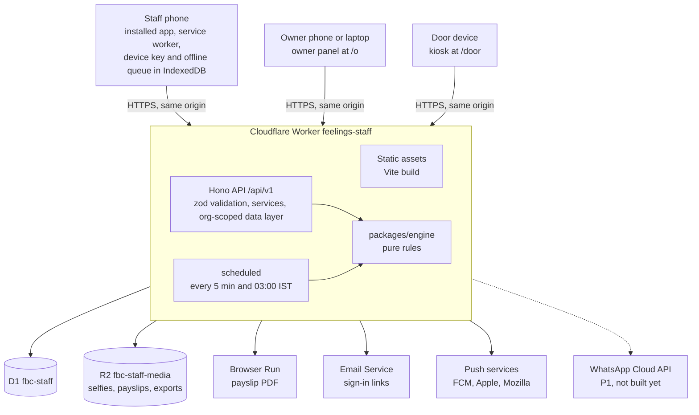
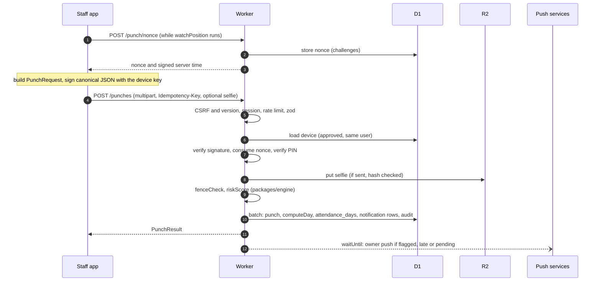
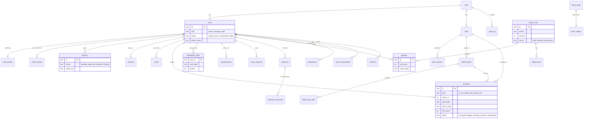
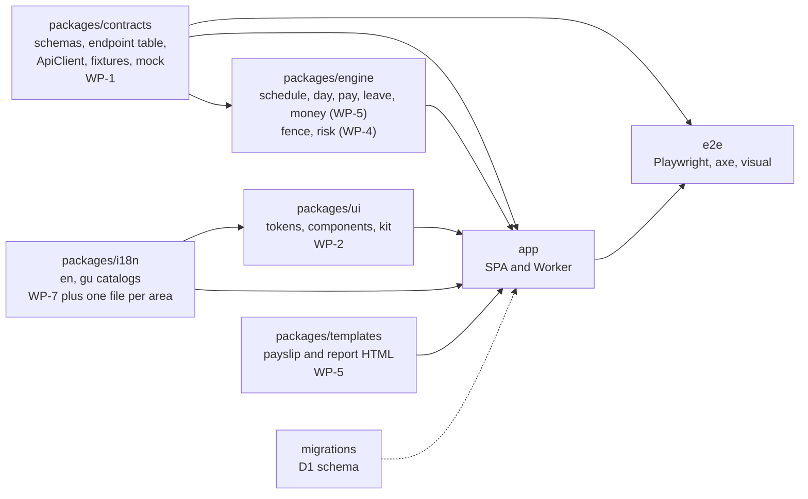

# Architecture

Feelings Staff is one Cloudflare Worker that serves the React app, the `/api/v1` API and the scheduled jobs, backed by D1 (database) and R2 (files). This page is the overview. The decisions behind it are in [`docs/decisions/`](decisions/README.md); the full requirements are in [`PRD.md`](PRD.md) (sections 13 to 16).

Contents: [System context](#system-context) · [A check-in, end to end](#a-check-in-end-to-end) · [Data model](#data-model) · [Packages and owners](#packages-and-owners) · [How the pieces connect](#how-the-pieces-connect) · [Environments](#environments) · [Decisions](#decisions)

## System context

Everyone talks to the same Worker over HTTPS with a cookie session. The Worker is the only thing that touches the database, the file store and the outside services.

Static files are served from assets. `/api/*`, `/v/*`, `/q/*`, `/__kit`, `/assets/*`, `/`, `/index.html`, `/sw.js`, `/manifest.webmanifest`, the split build folders `/_s/*` and `/_o/*` (always 404 under their own name) and the owner and staff page paths (`/o`, `/auth/owner`, `/signin`, `/join` and so on; the Worker passes them to the assets unchanged unless `OWNER_HOST` is set) (a missing hashed file is a real 404, never the shell) always reach the Worker code first (`run_worker_first`), everything else falls back to the single-page app ([ADR-01](decisions/0001-one-worker-for-assets-api-and-cron.md)).

What the Worker does on every `/api/*` request, in order:

1. Assign a request id and, on the way out, add the security headers (`app/worker/middleware/headers.ts`).
2. `guard`: CSRF (`Origin` and `X-FS-Client`), minimum app version, per-IP rate limit.
3. `context`: load the session and user, pick the organisation, build the org-scoped database (`OrgDb`), the services and the per-session rate limit.
4. The endpoint registered by `registerApi` ([ADR-15](decisions/0015-endpoint-table-drives-server-and-client.md)): access check, input parsing, step-up, idempotency, handler, response check.
5. Errors anywhere are turned into the standard error body ([API reference](api.md#error-shape-and-codes)).

## A check-in, end to end

PRD section 13.2 as a sequence. The check-in is a single `POST /punches`; everything that must commit together is one `DB.batch()`.

Steps 3 and 4 of PRD 13.2 in plain words:

- A request that fails a check stops there. A wrong PIN, an unapproved device or an approximate location stores nothing except a security audit row.
- The time that counts is the server time of the first submission. If the punch ends up pending (needs proof or approval) it keeps that time.
- A repeat of the same `Idempotency-Key` returns the first answer, so a double tap or a retry never records two punches.
- Offline punches are queued on the phone with a signed time anchor and an encrypted PIN, and sent later through the same endpoint (PRD 4.3.6).

## Data model

The main tables and how they relate. The complete list, conventions and retention are in the [data model](data-model.md). Every table except `orgs` and `app_meta` carries `org_id`; it is left out of the diagram for clarity.

Platform tables added after the first migration (`migrations/0002_platform.sql`): `idempotency_keys` and `test_outbox`.

Conventions that matter when you read the code: ids are ULIDs, instants are epoch milliseconds, dates are `YYYY-MM-DD`, money is integer paise, and the audit log is append-only.

## Packages and owners

Who owns what is the table in [CONTRIBUTING.md](../CONTRIBUTING.md#who-owns-what). In short:

| Package | Owner | What it holds |
|---|---|---|
| WP-1 platform | lead | Root configs, Worker entry, middleware, data layer, seed, ports, `packages/contracts`, `migrations/`, the E2E harness, `scripts/`, `.github/` |
| WP-2 design system | | `packages/ui`, styles, the kit page |
| WP-3 auth | | Sign-in, devices, staff accounts, invites, step-up |
| WP-4 attendance | | Punches, fence, risk, door QR, off-site duties, leave and fixes, owner Today and Needs action |
| WP-5 engine and payroll | | Pay rules, payroll runs, payslips, PDFs, exports, advances |
| WP-6 owner panel | | Owner screens and the public pages |
| WP-7 staff app and PWA | | Staff screens, service worker, offline queue, most i18n catalogs |
| WP-8 notifications and jobs | | Push, email, WhatsApp, the two cron jobs, inbox |

## How the pieces connect

- **One endpoint table.** `packages/contracts/src/endpoints.ts` is the API. The server registers it, the client and mock are built from it, and `docs/api.md` mirrors it ([ADR-15](decisions/0015-endpoint-table-drives-server-and-client.md)).
- **Ports.** `app/worker/services/ports.ts` defines the services a handler may use: `Clock`, `Audit`, `Notifier`, `StepUp`, `DayService`, `PayrollService`, `PdfRenderer`, `PushSender`, `EmailSender`, `MapsResolver` and `Outbox`. `services/registry.ts` wires the real ones. Tests replace them with fakes from `app/worker/test/fakes/`.
- **Data access.** Handlers use `ctx.db` (`OrgDb`, adds `org_id` to every statement) and, only before sign-in, `ctx.sys` (`SystemDb`). `scripts/check-arch.mjs` enforces this.
- **Pure rules.** `packages/engine` has no I/O. It computes a day (`computeDay`), a payslip, the fence result and the risk score from plain data, so it is tested with tables of cases.
- **Client.** Screens call `useApi()` and TanStack Query. The provider picks the real client or, on localhost with `?mock=1`, the mock ([ADR-16](decisions/0016-mock-mode-on-localhost-for-visual-baselines.md)). Copy comes from `packages/i18n` namespaces (`common`, `staff`, `owner`, `errors`, `notify`, `payslip`, `auth`, `door`, `ui`).
- **Test routes.** `/api/v1/__test/*` (reset a scenario, set the clock, run a cron job, read the outbox) exist only outside production and need the `X-E2E-Token` header.

## Environments

| Environment | Where | Database and files | Crons |
|---|---|---|---|
| CI and local | `wrangler dev` or `vite preview` on `localhost:8787`, inside GitHub Actions | Local D1 (Miniflare) | Run by hand with `/__test/cron` |
| Preview (per PR) | The Worker Preview URL the `preview` workflow posts on the PR | `fbc-staff-preview` and `fbc-staff-media-preview`, shared by all previews | Do not run |
| Production | `https://staff.feelingsbeautycare.in` | `fbc-staff` and `fbc-staff-media` | Run |

Setup steps are in [setup.md](setup.md), going live in [deploy.md](deploy.md).

## Decisions

| ADR | Decision |
|---|---|
| [01](decisions/0001-one-worker-for-assets-api-and-cron.md) | One Worker for assets, API and cron |
| [02](decisions/0002-react-and-vite-single-page-app-not-astro.md) | React and Vite single-page app, not Astro |
| [03](decisions/0003-tailwind-v4-with-a-locked-theme.md) | Tailwind v4 with a locked theme |
| [04](decisions/0004-d1-with-application-level-tenancy.md) | D1 with application-level tenancy |
| [05](decisions/0005-staff-sign-in-with-a-pin-and-a-device-bound-key-no-sms-otp.md) | Staff sign-in with a PIN and a device-bound key, no SMS OTP |
| [06](decisions/0006-server-time-ist-work-dates-integer-paise-and-exact-fractions.md) | Server time, IST work dates, integer paise and exact fractions |
| [07](decisions/0007-pdfs-through-browser-run-from-html-templates.md) | PDFs through Browser Run from HTML templates |
| [08](decisions/0008-web-push-with-pushforge-builder-behind-an-interface.md) | Web Push with `@pushforge/builder` behind an interface |
| [09](decisions/0009-email-through-cloudflare-email-service.md) | Email through Cloudflare Email Service |
| [10](decisions/0010-two-crons-and-an-idempotency-table-no-queues-in-v1.md) | Two crons and an idempotency table, no Queues in v1 |
| [11](decisions/0011-selfie-is-optional-and-there-are-no-biometrics.md) | Selfie is optional and there are no biometrics |
| [12](decisions/0012-contracts-first-in-a-pnpm-monorepo.md) | Contracts first, in a pnpm monorepo |
| [13](decisions/0013-polling-for-the-live-board.md) | Polling for the live board |
| [14](decisions/0014-leaflet-and-openstreetmap-loaded-lazily.md) | Leaflet and OpenStreetMap, loaded lazily |
| [15](decisions/0015-endpoint-table-drives-server-and-client.md) | Endpoint table drives server and client |
| [16](decisions/0016-mock-mode-on-localhost-for-visual-baselines.md) | Mock mode on localhost for visual baselines |
